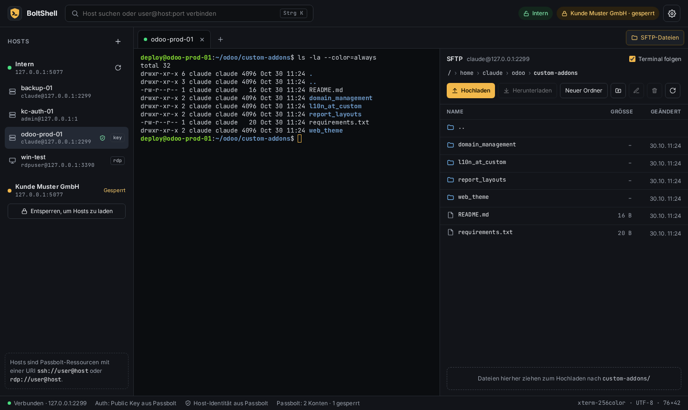

<p align="center">
  
</p>

<h1 align="center">BoltShell</h1>

**SSH & RDP for Passbolt** – a desktop app (Windows, macOS, Linux) for SSH terminals, file transfer (SFTP/SCP)
and remote desktops, with all credentials coming from your self-hosted [Passbolt](https://www.passbolt.com/).
Secrets are decrypted locally, only when a connection is opened.

[](https://github.com/Mahr-Software-IT-Solutions-e-U/boltshell/actions/workflows/build.yml)
[Download the latest release](https://github.com/Mahr-Software-IT-Solutions-e-U/boltshell/releases/latest)



> BoltShell is an independent open-source project and is not affiliated with or endorsed by Passbolt SA.
> "Passbolt" is a trademark of Passbolt SA.

- Several Passbolt accounts at once (e.g. internal + customer), each locked/unlocked separately, auto-lock after inactivity
- Multiple terminal sessions in tabs, each with its own connection; SFTP panel next to the terminal that can follow the shell's directory
- Quick connect (Ctrl+K): search hosts or connect directly to `user@host:port`
- Passbolt login via JWT + OpenPGP, Passbolt v4 and v5 (encrypted metadata, shared metadata keys, custom fields), TOTP
- Password, keyboard-interactive and private-key authentication (incl. encrypted keys); servers that also ask for a one-time code get it from the Passbolt TOTP of the resource, otherwise the user is asked
- Host identity from Passbolt (`ssh_host_key`, `rdp_cert_sha256`), otherwise trust-on-first-use with a warning on changed keys; sessions without a stored identity show a notice with a button to store it in Passbolt, a mismatch with Passbolt is refused and shown prominently (expected vs. presented fingerprint, replace only after explicit confirmation)
- SFTP upload/download (files, folders, drag & drop) with progress and cancel; symlinked folders can be opened; SCP fallback for servers without SFTP
- Host provisioning: turn a password-only host into a key-based Passbolt host (see below)
- RDP in tabs (IronRDP web client, NLA/CredSSP) with credentials from Passbolt; create RDP hosts incl. pinned server certificate
- Automatic updates from GitHub Releases: checked at start and every 6 hours, manual check and installed version on the accounts page
- Frameless window with the app's own title bar (set `"NativeTitleBar": true` in settings.json for the OS title bar)
- English and German UI (follows the OS language, switchable on the accounts page)

## Passbolt resource convention

A resource is an SSH host if one of its URIs starts with `ssh://`. Everything else (web logins etc.) is ignored.

| Passbolt field | Content |
|---|---|
| URI | `ssh://[user@]host[:port]`, IPv6 as `ssh://[2001:db8::1]:22` |
| Username | Login user, unless the URI contains one |
| Password | Login password. Only if the private key is **encrypted** and there is no `ssh_passphrase` field: the key passphrase |
| Custom field `ssh_private_key` | Private key (OpenSSH or PEM) |
| Custom field `ssh_passphrase` | Optional: key passphrase. Then the password field is the login password |
| Custom field `ssh_public_key` | Optional: public key belonging to the private key |
| Custom field `ssh_host_key` | Optional: host identity, one entry per line: `ssh-ed25519 AAAA…`, a known_hosts line, or `SHA256:…` fingerprint (`ssh-keygen -lf`) |

Custom fields need Passbolt v5. On Passbolt v4 put the private key into the **encrypted** note (resource type
"password with description" – never into the unencrypted description of a simple password).

**Host identity:** if `ssh_host_key` is set, the server must present one of those keys, otherwise the
connection is refused without a way to override it locally. Get the value on the server with
`cat /etc/ssh/ssh_host_ed25519_key.pub` or remotely with `ssh-keyscan host`.
Without `ssh_host_key` the app asks on first connect and remembers the key (trust on first use).

A key passphrase is never sent to the server as a login password.

**Several hosts in one resource:** every `ssh://` and `rdp://` URI of a resource (Passbolt v5 "additional URIs") is
its own host in the sidebar, with the resource's credentials – e.g. a cluster sharing a key, or a Windows server
reachable via RDP and SSH. The host identity fields then hold one entry per host, as known_hosts lines
(`host ssh-ed25519 AAAA…`, `[host]:2222 …`, wildcards and hashed entries work) or `host fingerprint` for
`rdp_cert_sha256`. Entries without a host apply to hosts without their own entry. "Store in Passbolt" adds or
replaces only the entry of the connected host.

### RDP hosts

| Passbolt field | Content |
|---|---|
| URI | `rdp://[DOMAIN\]user@host[:port]` (port defaults to 3389; `%5C` instead of `\` also works) |
| Username | Login user (also `DOMAIN\user`), unless the URI contains one |
| Password | Windows password |
| Custom field `rdp_domain` | Optional: domain |
| Custom field `rdp_cert_sha256` | Optional: server certificate fingerprint (hex as from `openssl x509 -fingerprint -sha256`, or base64); pins the server identity |

The **+** next to "Hosts" → *RDP-Host anlegen* stores a new RDP host (domain in the URI, works with Passbolt v4) and can
fetch the server's TLS certificate to pin it as `rdp_cert_sha256` after you confirm the fingerprint.

The IronRDP web client runs inside the app and talks to a local proxy (127.0.0.1, random port, per-session token)
that performs the TLS handshake with the server and verifies its certificate; NLA/CredSSP runs end to end.
Not supported yet: audio, drive redirection, multiple monitors.

## Host provisioning

The **+** next to "Hosts" → *SSH-Host provisionieren*: enter host/IP, port, an existing user and password,
choose the Passbolt account and folder. The app then

1. connects with the password and shows the host key for confirmation,
2. checks root/sudo (needed for root's key or sshd changes; the sudo password goes via stdin),
3. generates an Ed25519 key (in memory only),
4. adds the public key to `~/.ssh/authorized_keys` of **root** (default, then sets `PermitRootLogin prohibit-password`)
   or of the login user,
5. tests a fresh login with only the key,
6. creates the Passbolt resource (`ssh://root@host`, `ssh_private_key`, `ssh_public_key`, `ssh_host_key`) in the folder
   and shares it like the folder,
7. optionally disables password login via `/etc/ssh/sshd_config.d/00-boltshell.conf`, validated with `sshd -t`,
   then verifies that passwords are rejected and the key still works.

If a step before saving fails, the key (and a config written by the app) is removed again. If key login breaks after
disabling passwords, the change is reverted through the still-open first connection. The sshd drop-in requires an
`Include /etc/ssh/sshd_config.d/*.conf` line (default on Debian/Ubuntu/RHEL 9).

## Getting started

1. In the Passbolt browser extension: *Manage account → Desktop app setup → Download account kit*.
2. Start the app, add the account with `account-kit.passbolt`, unlock it with your passphrase.
3. Click a host in the sidebar to open a terminal; "SFTP-Dateien" opens the file panel next to it.
   More accounts can be added under the gear icon.

Settings, pinned host keys and the (passphrase-protected) Passbolt private key are stored in
`%APPDATA%\BoltShell` / `~/.config/BoltShell` / `~/Library/Application Support/BoltShell`.
No secrets are written to disk.

## Installation

Download from [Releases](https://github.com/Mahr-Software-IT-Solutions-e-U/boltshell/releases/latest).
Installed versions check GitHub for updates on start and offer them in the status bar.

| OS | File | Notes |
|---|---|---|
| Windows 10/11 | `BoltShell-win-Setup.exe` | Per-user install, no admin rights. Not code-signed yet: SmartScreen → *More info* → *Run anyway*. `BoltShell-win-Portable.zip` runs without installing. |
| macOS (Apple Silicon / Intel) | `BoltShell-osx-arm64-Setup.pkg` / `BoltShell-osx-x64-Setup.pkg` | Not notarized yet: right-click the app → *Open* the first time, or `xattr -dr com.apple.quarantine /Applications/BoltShell.app`. |
| Linux x64 | `BoltShell.AppImage` | `chmod +x BoltShell.AppImage`; needs `libwebkit2gtk-4.1` (`apt install libwebkit2gtk-4.1-0`). |

Every push to `main` builds all platforms (artifacts on the Actions run); a tag `vX.Y.Z` publishes a release.

## Development

```bash
dotnet build
dotnet test                                  # SSH integration tests use a local sshd if installed
dotnet run --project src/BoltShell.App
scripts/publish.sh            # or .\scripts\publish.ps1 on Windows; optional version argument
```

`scripts/publish.*` always writes to the fixed directory `dist/` (not in git):

| Path | Content |
|---|---|
| `dist/win-x64/` | Ready-to-run app (self-contained) |
| `dist/releases/BoltShell-win-Setup.exe` | Installer |
| `dist/releases/BoltShell-win-Portable.zip` | Portable version |
| `dist/releases/*.nupkg`, `releases.win.json` | Update packages; keep this folder so new builds get delta updates |

The version comes from `<Version>` in `src/BoltShell.App/BoltShell.App.csproj`; raise it before publishing a new build.

| Project | Content |
|---|---|
| `src/BoltShell.Core` | Passbolt client, OpenPGP, SSH/SFTP sessions, settings (no UI) |
| `src/BoltShell.App` | Photino.Blazor desktop host, Razor components (xterm.js; MudBlazor for dialogs) |
| `tests/BoltShell.Core.Tests` | Unit tests incl. a fake Passbolt server with real PGP, SSH integration tests |

Translations: user-facing texts are written in English and wrapped in `Tr("…")` (`BoltShell.Core.Localization.Texts`);
German translations live in `i18n/de/*.json` next to the code (one catalog per component). `LocalizationTests` fail on
missing or stale translations and on mismatched placeholders. A new language = a new `i18n/<code>/` folder plus an entry in `Texts.Languages`.

## License

GPL-3.0-or-later, see [LICENSE](LICENSE). Third-party components and their licenses: [THIRD_PARTY_NOTICES.md](THIRD_PARTY_NOTICES.md).
Security issues: see [SECURITY.md](SECURITY.md).
